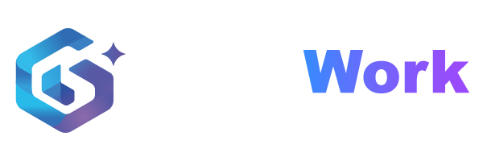

<!-- TODO: 替换为组织 Logo -->

# GHH Work

**用 AI 驱动的软件开发团队**

---

## 关于我们

GHH Work 是一支以 AI 为核心开发方式的软件团队。我们把大模型能力深度融入需求分析、架构设计、编码实现与测试交付的完整流程，让 AI 成为团队每一位工程师的"结对伙伴"，而不只是辅助工具。

我们相信：**AI 不会取代开发者，但会重塑开发的方式。** 我们的目标是用更小的团队、更快的节奏，交付更高质量的软件产品。

## 我们如何工作

- **AI 优先** —— 从第一行需求到最终上线，AI 参与每一个环节
- **人机协作** —— 由人把控方向与质量，由 AI 承担重复与规模化的工作
- **快速迭代** —— 缩短从想法到可用产品的距离
- **开放透明** —— 沉淀实践，与社区共享我们的方法与工具

## 我们在做什么

<!-- TODO: 补充团队当前的主要项目或方向 -->

- 🚧 项目一：待补充
- 🚧 项目二：待补充

## 联系我们

<!-- TODO: 补充联系方式 -->

- 网站：待补充
- 邮箱：待补充

---

*Built with AI, by humans.*

